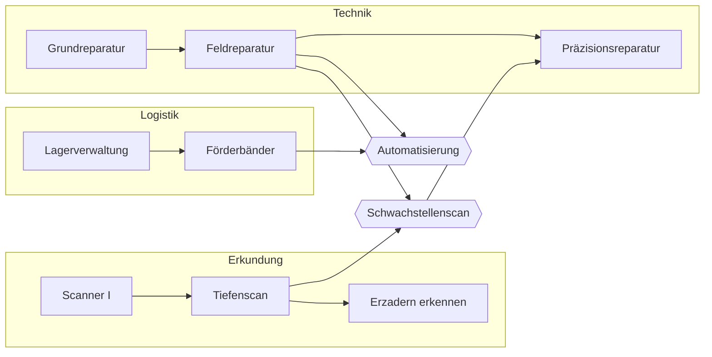

# Project Onyx – Game Design Document

> **Stand:** 30.10.2026 · Entwurf 03
> **Legende:** ✅ entschieden · 💡 Vorschlag (noch zu bestätigen) · ❓ offen

---

## 1. Eckdaten

| Thema | Festlegung | Status |
|---|---|---|
| Genre | Koop-Survival mit Basisbau, Management und Logistik | ✅ |
| Spielerzahl | 2–4 Spieler | ✅ |
| Plattform | PC, Release auf **Steam** | ✅ |
| Engine | Unity 6 (LTS), Universal Render Pipeline mit 2D-Licht | ✅ |
| Perspektive | Top-down 3/4 (Draufsicht wie *Stardew Valley*), keine Seitenansicht | ✅ |
| Grafik | Pixelart, **16 × 16 px Kacheln**, **Figuren 16 × 32 px** | ✅ |
| Setting | Weltraum, dystopisch | ✅ |
| Arbeitstitel | Project Onyx | ✅ |

## 2. Vision

Eine kleine Crew erkundet gemeinsam eine Galaxie, in der die Natur wunderschön ist und alles, was Zivilisationen hinterlassen, verrostet, verseucht und kaputt ist. Die Spieler überleben, bauen Stützpunkte und Versorgungsnetze auf, handeln und streiten mit Fraktionen und werden mit der Zeit zu Spezialisten, die sich gegenseitig brauchen.

### Design-Säulen

1. **Koop durch Abhängigkeit** – Jeder kann alles, aber trainierte Spezialisten sind deutlich besser und sehen Dinge, die andere nicht sehen. Kommunikation ist nötig, nicht optional. ✅
2. **Freie Erkundung** – Kein Zeitlimit. Grenzen setzen nur Ausrüstung und Umwelt (Sauerstoff, Schilde, Tragkraft, Hitze, Strahlung). ✅
3. **Natur schön, Zivilisation rostig** – Die Dystopie entsteht durch Fraktionen, Abbau und Ausbeutung, nicht durch trostlose Planeten. ✅ (aus der Art Direction)
4. **Lernen durch Tun** – Fähigkeiten steigen, indem man die Tätigkeit ausübt. ✅
5. **Die Welt läuft weiter** – Jeder kann jederzeit in die gemeinsame Welt, auch ohne Host. ✅

## 3. Ausgangslage

### 3.1 Der Einstieg ✅

Die Crew einer Fregatte verliert eine Weltraumschlacht. Die Spieler entkommen in **Fluchtkapseln** und **notlanden auf einem Planeten**. Auch die **Fregatte ist auf dem Planeten abgestürzt**.

### 3.2 Akt 1: Die Absturzstelle 🔨

- **Getrennte Landung:** Jeder Spieler landet in einer eigenen Kapsel, verstreut in der Umgebung. Erstes Ziel: sich gegenseitig finden, indem man Landmarken beschreibt („roter Felsbogen, Rauch im Osten“). Das bringt Kommunikation bei, ohne wie ein Tutorial zu wirken.
- **Die Kapsel als erster Rückzugsort:** Sauerstoff nachfüllen, Notsender, kleines Lager – der erste Versorgungspunkt (siehe 4.2).
- **Die Fregatte wird das Schiff der Crew:** Wrack finden, bergen, reparieren und abheben. Das Abheben ist der Übergang zur Schiffs- und Galaxie-Ebene und erklärt, warum alles geflickt ist.
- **Frühe Bedrohung:** Die Sieger der Schlacht durchsuchen die Absturzstelle. Das bringt die erste Fraktion ins Spiel.
- **Frühere Posten an Bord** geben kleine Startboni in einer Disziplin (z. B. ehemaliger Bordtechniker → etwas Technik).

**Umgesetzt in M1 (erste spielbare Fassung):** Alle starten gemeinsam in *einer* Kapsel (getrennte Landung folgt später). Die Kapsel füllt Sauerstoff auf. Draußen sinkt der Sauerstoff, nachts kommt Kälte dazu. Im Wrack ist man vor Kälte geschützt, aber ohne Luft, bis der **Sauerstoffgenerator** läuft. Der **Reaktor** bringt Strom und Licht. Erst danach lässt sich der **Antrieb** reparieren, dann ist die Fregatte startklar. Reparieren: E halten, mehrere Spieler gleichzeitig sind schneller. Kampfunfähige werden von Mitspielern wiederbelebt. Sind alle am Boden, holt die Rettungsautomatik der Kapsel sie zurück.

### 3.3 Offen ❓

- Wer hat die Schlacht gewonnen, und für wen hat die Fregatte gekämpft?
- Was ist das langfristige Ziel nach dem Abheben (z. B. freie Kolonie gründen)?

## 4. Spielstruktur

### 4.1 Drei Ebenen ✅

| Ebene | Was passiert dort | Darstellung |
|---|---|---|
| **Planet** | Erkunden, Sammeln, Kämpfen, Außenposten bauen | Top-down, Biome mit eigenem Farbklang |
| **Schiff** | Heimatbasis: ausbauen, recyceln, herstellen, Ausrüstung wechseln | Top-down, Räume mit Funktionen |
| **Galaxie** | Reiseziele wählen, Fraktionsgebiete, Handelsrouten | Sternenkarte |

### 4.2 Freie Erkundung ✅

- Kein Zeitlimit auf Planeten.
- **Weiche Grenzen** durch Ressourcen der Ausrüstung: Sauerstoff, Schildenergie, Tragkraft; je nach Biom zusätzlich Hitze, Kälte, Strahlung, Gift.
- **Fortschritt heißt weiter kommen:** Bessere Ausrüstung (Hitzeanzug, größere Tanks, stärkere Schilde) erschließt neue Biome und tiefere Gebiete. 💡
- **Außenposten als Versorgungspunkte** (Sauerstoff nachfüllen, Schilde laden, Lager) machen weitere Vorstöße möglich. 💡

### 4.3 Krisen aus der Welt 💡

Ohne Timer kommt Spannung aus Ereignissen, die die Gruppe zusammenziehen:
- Stürme und Umweltereignisse auf Planeten
- Tag/Nacht: Nachts ist es gefährlicher
- Angriffe auf Außenposten und Schiff (Piraten, Fauna)
- Schiffskrisen (Hüllenbruch, Reaktorausfall)

### 4.4 Raids (Endgame) ✅

Spezielle Orte (z. B. Konzerndepots, Piratennester, Schwarmwelten), an denen nach der Landung **die Bedrohung immer weiter eskaliert**, bis die Crew fliehen muss. Nur gut ausgerüstete, erfahrene Gruppen bestehen.

Ausgestaltung 💡:
- **Eskalationsstufen** statt starrer Uhr. Die Kernentscheidung lautet: „Noch weiter plündern oder jetzt raus?“
- **Abholung als Teamaufgabe:** Das Schiff muss landen und gehalten werden, während die anderen sich mit der Beute zurückkämpfen.
- **Exklusive Beute:** seltene Baupläne, Artefakte, Material für Top-Ausrüstung.
- **Zufällige Modifikatoren** (z. B. Giftatmosphäre, doppelte Piraten) für Wiederspielwert.
- **Scheitern:** Verlust der getragenen Beute und Ausrüstungsschäden, kein Verlust des Charakters.

### 4.5 Mechaniken über die Kampagne freischalten 💡

Damit der Spielablauf abwechslungsreich bleibt, kommen Mechaniken schrittweise dazu:

1. **Überleben** – Sauerstoff, Nahrung, Reparaturen, Recycling von Schrott
2. **Ausbreiten** – Außenposten, die weiterproduzieren, während man weg ist, und Handel
3. **Politik** – Fraktionsruf, Aufträge, Sabotage, Bündnisse
4. **Logistik im Großen** – Versorgungsrouten zwischen Planeten, Automatisierung
5. **Endgame** – Raids, Kolonie gründen bzw. Konfrontation mit dem Konzern

### 4.6 Fraktionen und Konzern-Druck 💡

- Fraktionen (Arbeitstitel: Konzern, Synth-Kollektiv, Schrottgilde) mit eigenen Gebieten, Zielen und Ruf.
- **Hitze-Wert:** Plündern, Schmuggeln und Sabotage erhöhen die Aufmerksamkeit des Konzerns, was zu mehr Patrouillen und Kopfgeldjägern führt.
- **Ausbeuten oder schonen:** Abbau verändert Planeten sichtbar. Schnelle Ausbeutung bringt mehr Ressourcen, aber mehr Hitze und verärgerte Fraktionen. Nachhaltigkeit und Recycling sind langsamer, bringen aber Verbündete.

## 5. Fortschritt: Disziplinen und Skilltree

### 5.1 Grundprinzip ✅

- **Keine festen Klassen.** Jeder Charakter kann jede Tätigkeit ausüben.
- **Lernen durch Tun:** Wer eine Tätigkeit ausübt, sammelt Erfahrung in der zugehörigen Disziplin.
- Trainierte Charaktere sind **effektiver** und **schalten neue Fähigkeiten frei**.
- **Obergrenze:** Niemand kann alles meistern.
- **Skilltree mit Querverbindungen:** Die Bäume der Disziplinen schneiden sich und bedingen sich gegenseitig. Beispiel: Für eine bestimmte Ingenieur-Fähigkeit braucht man eine Fähigkeit aus dem Scout-Baum.

### 5.2 Disziplinen

| Disziplin | Rolle | Typische Tätigkeiten | Status |
|---|---|---|---|
| **Erkundung** | Scout | Scannen, Kartieren, Fährten lesen, Gefahren erkennen | ✅ |
| **Technik** | Ingenieur | Bauen, Reparieren, Energie, Schiffssysteme | ✅ |
| **Diplomatie** | Diplomat | Handeln, Verhandeln, Übersetzen, Fraktionsruf | ✅ |
| **Logistik** | Logistiker | Lager, Transport, Förderbänder, Drohnenrouten, Recycling | ✅ |
| Kampf, Medizin | – | – | ❓ eigene Disziplinen oder Teil der anderen? |

### 5.3 Fortschrittsmodell 💡

- Jede Disziplin hat **Stufen 0–20**. Erfahrung kommt aus sinnvollen Tätigkeiten der Disziplin.
- Jede Stufe gibt **einen Skillpunkt für den Baum dieser Disziplin**.
- **Obergrenze:** Die Summe aller Disziplinstufen ist auf **50** begrenzt (von maximal 80). Das reicht für zwei Meisterdisziplinen und eine halbe dritte.
  - Bei **2 Spielern** decken zwei Charaktere mit je zwei Meisterdisziplinen alle vier Disziplinen ab.
  - Bei **4 Spielern** gibt es Überschneidungen und Raum für Spezialisten.
- **Umlernen:** An der Obergrenze kann jeder Spieler pro Disziplin festlegen: *steigern ↑ / senken ↓ / sperren 🔒* (angelehnt an *Ultima Online*). Neue Erfahrung in einer ↑-Disziplin wird dann von einer ↓-Disziplin abgezogen. Spezialisierungen lassen sich so langsam und bewusst wechseln.
- Fällt eine Disziplin unter die Anforderung eines freigeschalteten Knotens, wird dieser **inaktiv** (nicht gelöscht) und kommt zurück, sobald die Stufe wieder reicht.

### 5.4 Querverbindungen 💡

Ein Knoten gehört immer zu genau einem Baum und kostet dessen Punkte. **Voraussetzungen dürfen aber aus anderen Bäumen kommen.** Zwischen je zwei Disziplinen liegen **Hybrid-Fähigkeiten**. Bei vier Disziplinen ergibt das sechs Paare:

| Paar | Hybrid-Fähigkeit (Beispiel) | Wirkung |
|---|---|---|
| Erkundung + Technik | **Schwachstellenscan** | Scan zeigt Schwachstellen an Maschinen, Wracks und Gegnern; Reparaturen schneller |
| Erkundung + Logistik | **Pfadfinder** | Erkundete Wege beschleunigen Träger und Drohnenrouten |
| Erkundung + Diplomatie | **Aufklärung** | Informationen über eine Fraktion geben Vorteile in Verhandlungen |
| Technik + Logistik | **Automatisierung** | Förderbänder und Drohnen bauen und vernetzen |
| Technik + Diplomatie | **Fremdtechnik** | Technik anderer Fraktionen verstehen und nachbauen |
| Logistik + Diplomatie | **Handelsnetz** | Handelsrouten, Schmuggel, bessere Preise |

Beispiel als Ausschnitt:

### 5.5 Was hohe Stufen bringen 💡

- **Effizienz:** schneller, günstiger, sicherer.
- **Wahrnehmung:** Hohe Stufen schalten Informationen frei, die andere nicht sehen. Ein Scout sieht seltene Erzadern, ein Ingenieur Schwachstellen, ein Diplomat versteht Fraktionssprachen. Dadurch bleibt Kommunikation nötig.
- **Sichtbarkeit:** Freigeschaltete Ausrüstung verändert die Silhouette der Figur. Man sieht, wer der erfahrene Ingenieur ist.

### 5.6 Gegen Grinden, für Zusammenspiel 💡

- Erfahrung nur für **sinnvolle** Aktionen, abhängig von der Schwierigkeit. Wiederholungen bringen abnehmend weniger.
- **Mentoring:** Wer neben einem deutlich erfahreneren Mitspieler dieselbe Tätigkeit ausübt, lernt schneller. Später einsteigende Freunde holen so auf.

### 5.7 Umsetzung (M3) 🔨
- **Charakter gehört dem Spieler:** Disziplinen, Erfahrung und Fähigkeiten liegen in `charakter.json` beim Spieler und wandern in jede Welt mit (wie bei Terraria). Die Welt speichert der Host.
- **Erfahrung durch Tun:** Reparieren → Technik (2 EP je Arbeitssekunde, Anteil nach eigenem Tempo); Wege draußen → Erkundung (0,25 EP je Kachel); neues Sternsystem → 60 EP Erkundung.
- **Erste Wirkungen:** +3 % Reparaturtempo je Technikstufe, „Grundreparatur“ +20 %, „Leichter Schritt“ −20 % Sauerstoffverbrauch.
- **Skilltree-Bildschirm (K):** vier Spalten, Linien zu Voraussetzungen, Querlinien für Hybride; Klick schaltet frei; Umlern-Einstellung je Disziplin per Klick.

## 6. Multiplayer und Persistenz

### 6.1 Anforderungen ✅

- 2–4 Spieler, Koop.
- **Jeder kann jederzeit verbinden**, auch wenn der ursprüngliche Host offline ist.
- **Allein weiterspielen ist erlaubt** – die Welt gehört der Gruppe.

### 6.2 Architektur 💡

- **Host = Server + Spieler:** Die Spiellogik läuft immer serverseitig (beim Host). Derselbe Code kann später als dedizierter Server laufen.
- **Welt in der Cloud:** Der Weltstand liegt online (Unity Cloud Save o. ä.). Wer zuerst startet, lädt die Welt und wird Host.
- **Sperre:** Eine laufende Sitzung sperrt die Welt („läuft gerade bei X“). Andere treten dieser Sitzung bei, statt eine zweite zu öffnen. Die Sperre läuft bei Absturz automatisch ab.
- **Autosave** alle paar Minuten; bei Absturz des Hosts gehen höchstens wenige Minuten verloren.
- **Welt und Charaktere getrennt:** Die Welt gehört der Gruppe, Charakter und Skills gehören dem Spieler.
- **Speichern in Abschnitten:** Die Welt ist in Abschnitte geteilt (Planeten, Kartenbereiche); nur Geändertes wird hochgeladen.
- **Abwesenheit per Zeitstempel:** Außenposten produzieren abstrakt weiter; beim Laden wird die vergangene Zeit nachgerechnet.
- **Verbindung über Steam** (Steam Datagram Relay), damit Spieler hinter Heimroutern zueinander finden.
- **Optional später:** dedizierte Server, die Spielergruppen selbst betreiben (eigener PC oder gemieteter Server).

### 6.3 Bewusst nicht im ersten Schritt

- Nahtloser Host-Wechsel während einer laufenden Sitzung. Verlässt der Host das Spiel, startet jemand anderes vom letzten Autosave neu.

## 7. Art Direction

Siehe Art-Direction-Board (Design-Canvas „Art Direction – Koop-Weltraumspiel“). Kernregeln:

- **Licht ist Leben:** Dunkle Welt, warmes Licht dort, wo die Crew aktiv ist.
- **Ein Farbklang pro Biom** plus ein Gegenakzent.
- **Rollen auf einen Blick:** Visier und Ausrüstung in Disziplinfarben, eigene Silhouetten.
- **Rot ist ausschließlich Gefahr.**
- Draufsicht mit Tiefe: Objekte zeigen Front und Dach, werfen Schatten, große Objekte ragen ins Bild.
- Technik: 16-px-Kacheln, Figuren 16 × 32, Pixel Perfect Camera, URP-2D-Licht.

## 8. Technik

| Bereich | Lösung | Status |
|---|---|---|
| Engine | Unity 6 LTS, Vorlage „Universal 2D“ | ✅ |
| Rendering | URP 2D Renderer, 2D-Licht, Pixel Perfect Camera, Y-Sortierung | 💡 |
| Netzwerk | Netcode for GameObjects, Host als Server | 💡 |
| Transport | Steam (Steamworks + Steam-Transport für NGO) – Auswahl in M0 | 💡 |
| Speicherung | Unity Cloud Save für Welten, Steam-Login – prüfen in M2 | 💡 |
| Spiellogik | Reines C# ohne Unity-Abhängigkeit (Skills, Überleben, Simulation, Speicherformat), automatisiert getestet | 💡 |

**Kosten (Schätzung):** Während Entwicklung und mit kleiner Community praktisch 0 €. Unity Personal ist bis 200.000 $ Umsatz kostenlos; Cloud Save hat ein großzügiges kostenloses Kontingent; das Steam-Relay ist für Steam-Spiele kostenlos. Die Steam-Veröffentlichung kostet einmalig 100 $.

## 9. Roadmap

> Ausführlich mit Phasen und nächsten Schritten: **[Roadmap.md](Roadmap.md)**. Hier nur die Meilensteine von Phase 1.

| Meilenstein | Inhalt | Frage, die er beantwortet |
|---|---|---|
| **M0a** | Zwei Spieler verbinden sich per IP und laufen gemeinsam über eine Tilemap (Platzhalter-Grafik, Pixel Perfect Camera) | Steht das Netzwerk-Fundament? |
| **M0b** | Verbindung über Steam statt IP | Klappt es über das Internet ohne Portfreigabe? |
| **M1** | Die Absturzstelle: Sauerstoff und Schilde, Kapsel als Nachfüllstation, kaputtes Modul an der Fregatte gemeinsam reparieren, Nacht und 2D-Licht | Fühlt sich der Koop-Kern gut an? |
| **M2** | Welt in Abschnitten speichern, Cloud-Sperre, jeder kann hosten | Funktioniert die geteilte Welt? |
| **M3** | Disziplin Technik mit Lernen durch Tun und ersten Skillknoten | Macht Lernen durch Tun Spaß? |
| **Playtest 1** | Gemeinsam spielen, auswerten | Weiter so oder umsteuern? |
| parallel | Kernlogik und Dev-Modus für Galaxie, Reisen, Skilltree, Schiffswerft (siehe 10 und 11) | Sind die Systeme stimmig, bevor es echte Oberflächen gibt? |
| ✅ | Sternenkarte im Spiel (Taste M) im Art-Direction-Stil | Trägt der Look auch im Spiel? |
| danach | Echte UI für Werft und Skilltree; begehbares Schiff, Planeten, Fraktionen, Raids | – |

## 10. Systeme: Galaxie, Reisen, Werft

### 10.1 Galaxie 💡
- **Pro Welt aus einem Seed erzeugt** (Wiederspielwert; alle Spieler sehen dieselbe Karte, gespeichert wird nur der Fortschritt).
- ca. 24 Sternsysteme mit 1–5 Planeten (Rostwüste, Savanne, Dschungel, Eis, Gift, Vulkan, Ödland, Gasriese), Gefahrenstufe 0–3.
- **Sprungverbindungen**: Jedes System ist erreichbar (Spannbaum), dazu kurze Zusatzwege für Rundrouten.
- **Fraktionsgebiete** (Konzern, Synth-Kollektiv, Schrottgilde) in den Randbereichen; das Startsystem ist frei und hat eine sichere Rostwelt (Absturzstelle).
- Systeme sind unbekannt, bis man sie besucht (später auch per Scanner).

### 10.2 Reisen 💡
- Sprünge nur entlang von Verbindungen. Kosten: **Treibstoff pro Lichtjahr**.
- **Sprungreichweite** hängt vom Schiff ab (Schub im Verhältnis zur Masse). Lange Verbindungen erfordern ein ausgebautes Schiff – so erschließt der Werftausbau neue Gebiete.
- Innerhalb eines Systems: Umlaufbahn um Planeten ohne Treibstoff; Landen folgt mit den Planetenkarten.

### 10.3 Schiffswerft ✅ (frei ausbaubar) / Details 💡
- Das Schiff ist ein **Bauplan auf dem 16-px-Kachelraster**: Rumpfkacheln (begehbarer Boden) und Module mit fester Größe, drehbar um 90°.
- Module (erste Liste): Cockpit, Reaktor, Solarpaneel, Triebwerk, Treibstofftank, Sauerstoffgenerator, Hydroponik, Frachtraum, Koje, Krankenstation, Werkbank, Recycler, Schildgenerator, Luftschleuse, Langstreckenscanner.
- Aus dem Bauplan ergeben sich **Schiffswerte** (Energiebilanz, Sauerstoff, Fracht, Tank, Schub, Masse, Reichweite, Kojen, Schild, Kosten) und eine **Mängelliste** (z. B. Energiemangel, kein Cockpit).
- Startschiff ist die **abgestürzte Fregatte** aus Akt 1.
- Später: Baukosten in Schrott, Bauen nur in der Werft bzw. mit Werkbank, das Schiff als begehbare Karte in der Welt.

## 11. Dev-Modus ✅

Taste **F1** im Editor und in Entwickler-Builds: Konsole mit Befehlen (`help`), Sternenkarte zum Springen und Route planen, Skills (EP geben, Stufen setzen, freischalten, Umlernen), Schiffswerft (Rumpf malen, Module setzen) und Welt (Tageszeit, Zeitraffer, neue Welt). Jedes neue System bekommt hier seine Testfunktionen.

## 12. Offene Fragen ❓

- Gegner der Eröffnungsschlacht und Kampagnenziel nach dem Abheben (Abschnitt 3.3)
- Kampf und Medizin: eigene Disziplinen oder Teil der vier?
- Konkrete Zahlen für Stufen, Obergrenze und Umlernen
- Wie stark wird die Galaxie-Ebene (Strategie) ausgebaut?
- Name des Spiels
