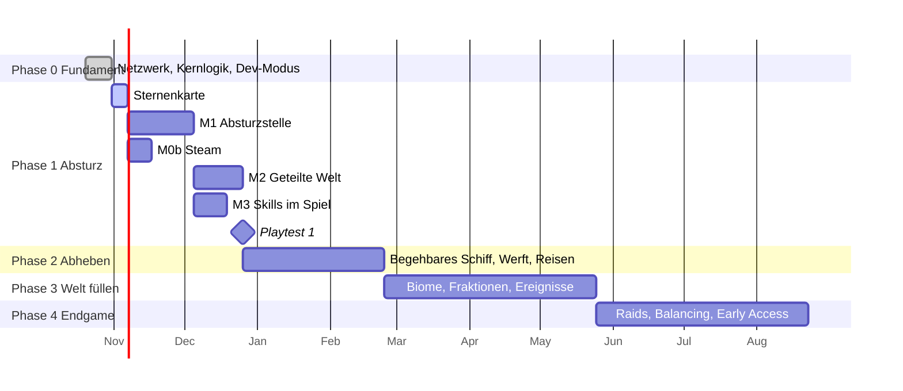

# Project Onyx – Roadmap

> Stand: 31.10.2026 · Lebendes Dokument: Wir haken ab, verschieben und streichen, sobald wir mehr wissen.
> Legende: ✅ fertig · 🔨 in Arbeit · ⏳ als Nächstes · 💤 später

## Leitgedanke

Wir bauen **von innen nach außen**: zuerst ein kleiner, spielbarer Kern (Absturzstelle, zu zweit), der Spaß macht. Danach öffnen wir Schritt für Schritt das Weltall. Jede Phase endet mit einem **Playtest** und einer klaren Frage, nach der wir entscheiden: weiter so oder umsteuern.

Für jede Phase gilt:
- Spiellogik in **Onyx.Core** mit Tests, erst danach Unity-Oberfläche.
- Jedes neue System bekommt **Befehle im Dev-Modus** (F1).
- Grafik bleibt Platzhalter, bis ein System spielerisch trägt. Die Ausnahme sind Bildschirme, die den Look festlegen (z. B. die Sternenkarte).

*Die Zeiten sind grobe Richtwerte für ein kleines Team in der Freizeit. Es zählt die Reihenfolge, nicht das Datum.*

---

## Phase 0 – Fundament ✅

| Was | Stand |
|---|---|
| Repo, Unity 6 (URP 2D), Netcode for GameObjects, Ordner- und Assembly-Aufbau | ✅ |
| **M0a**: Host/Join per IP, bis zu 4 Spieler laufen gemeinsam (Pixel Perfect 480 × 270) | ✅ |
| Kernlogik: Sauerstoff/Schilde, Reparatur im Team, Tag/Nacht | ✅ |
| Kernlogik: Galaxie aus Seed, Sprünge und Routen, Skilltree mit Querverbindungen, Schiffswerft | ✅ |
| Dev-Modus (F1): Konsole, Galaxie, Skills, Werft, Welt | ✅ |
| CI: Kerntests laufen bei jedem Push auf GitHub | ✅ |

## Phase 1 – Vertical Slice „Der Absturz“ 🔨

**Ziel:** 2–4 Leute überleben gemeinsam an der Absturzstelle und reparieren die Fregatte so weit, dass sie den ersten Sprung schafft.
**Frage für den Playtest:** Macht der Koop-Kern Spaß – auch ohne Weltall?

| # | Paket | Inhalt | Stand |
|---|---|---|---|
| 1.1 | **Sternenkarte** | Taste M: Pixelkarte im Art-Direction-Stil (Fraktionsgebiete, Sprungwege, Route, Schiffsposition), System wählen, Route planen, springen | ✅ erste Version |
| 1.2 | **M1 Absturzstelle** | Gelände aus Seed (Platzhalter-Tiles Rostwüste), Kapsel füllt Sauerstoff, HUD für O2/Schild/Leben, begehbares Fregattenwrack mit drei kaputten Systemen (Sauerstoffgenerator → Luft im Wrack, Reaktor → Strom und Licht, Antrieb → Sprung möglich), gemeinsam reparieren mit E, Nachtkälte, Wiederbeleben, Rettung zur Kapsel | 🔨 spielbar, wartet auf Playtest |
| 1.3 | **M0b Steam** | Steamworks (Facepunch.Steamworks), Lobby + Einladen über Freunde-Liste, Steam-Transport statt IP | ⏳ braucht App-ID |
| 1.4 | **M2 Geteilte Welt** | ✅ Spielstand speichern/laden beim Host (Autosave, JSON) · ✅ Charakter liegt bei jedem Spieler · ✅ Mitspieler bekommen beim Beitreten und nach jeder Änderung den ganzen Stand (Schiff, Galaxie, Reparaturen), Sprünge fragen beim Host an. Offen: Welt teilen, sodass jeder hosten kann (Steam Cloud bzw. Weitergabe des Spielstands), Sperre gegen doppeltes Hosten | 🔨 |
| 1.5 | **M3 Skills im Spiel** | ✅ Reparieren gibt Technik-EP, Wege draußen und neue Systeme geben Erkundungs-EP; Technikstufe und „Grundreparatur“ machen schneller, „Leichter Schritt“ spart Sauerstoff; Skilltree-Bildschirm (K) im Pixel-Stil mit Umlernen; Charakter speichert jeder Spieler selbst. Offen: Diplomatie/Logistik-EP (brauchen Handel und Lager), Wirkung weiterer Knoten | 🔨 |
| 1.6 | **Playtest 1** | Zu zweit/zu dritt eine Stunde spielen, Notizen, Entscheidung | 💤 |

## Phase 2 – Abheben 💤

**Ziel:** Die Fregatte fliegt. Man baut sie aus, springt in andere Systeme und landet auf neuen Planeten.
**Frage:** Trägt die Schleife „erkunden → sammeln → Schiff ausbauen → weiter“?

- **Begehbares Schiff aus dem Bauplan**: Das Werft-Raster wird zu echten Räumen (Cockpit, Reaktor, Betten …), in denen man herumläuft.
- **Werft-Oberfläche** im Spiel statt im Dev-Modus: Module platzieren, Kosten, Fehlermeldungen („zu wenig Energie“).
- **Ressourcen und Inventar**: Schrott, Erz, Treibstoff; Fabrikator und Recycler.
- **Landen auf erzeugten Planeten**: Planet aus Seed + Typ (Rostwüste, Eis, Dschungel …), Gefahrenstufe wirkt auf Sauerstoff/Schilde.
- **Reisen**: Treibstoff als echte Ressource; Sprung, Orbit und Landung als Ablauf mit kurzer Übergangsszene.
- **Playtest 2**

## Phase 3 – Die Welt füllen 💤

**Ziel:** Es gibt Gründe, an bestimmte Orte zu fliegen, und die Galaxie reagiert auf die Spieler.

- Mehr Biome mit eigener Flora/Fauna und Gefahren
- Außenposten und Stationen (Handel, Aufträge)
- **Fraktionen**: Ruf, Handel, Diplomatie, Konzern-Druck (Heat)
- **Krisen und Ereignisse** aus der Welt (Stürme, Reaktorlecks, Piraten)
- Kompletter Skilltree über alle vier Disziplinen inkl. Hybride
- Logistik: Lager, Förderbänder, Automatisierung
- **Playtest 3**

## Phase 4 – Endgame und Veröffentlichung 💤

- **Raids**: zeitlich begrenzte Plünderungen mit steigender Bedrohung bis zur Flucht
- Kampagnenziel (Was ist mit der Flotte passiert? Wer hat die Schlacht gewonnen?)
- Balancing, Speicherstände absichern, Optionen, Tastenbelegung, Controller
- Steam-Seite, Trailer, Demo / Early Access

---

## Parallele Spuren

| Spur | Nächste Schritte |
|---|---|
| **Grafik** | Tileset Rostwüste (Boden, Felsen, Wrackteile), Spielerfigur 16 × 32 mit 4-Richtungen-Laufanimation, Fluchtkapsel, Fregatten-Wrack, HUD-Elemente |
| **Audio** | Platzhalter-Sounds (Schritte, Reparatur, Alarm), später eigene Musik |
| **Infrastruktur** | Steam-App-ID (100 $ Steam Direct), Build-Pipeline für Test-Builds, Crash-Logs |
| **Team** | Zweiter Entwickler: Unity Smart Merge, Team-Leitfaden, GitHub Issues pro Paket |

## Die nächsten Schritte (konkret)

1. **Sternenkarte im Spiel testen** (M drücken) und Feedback zum Look geben.
2. **M1 Absturzstelle ausprobieren** (Menü Onyx → Setup → M1-Absturzstelle erstellen, dann Play → Hosten), am besten zu zweit; danach Feinschliff: echte Grafik, Werte, Sounds.
3. **Steam-App-ID beantragen** – das dauert ein paar Tage und blockiert M0b.
4. Wenn der Freund mitmacht: **Team-Workspace** einrichten (Smart Merge, Leitfaden, Issues).
